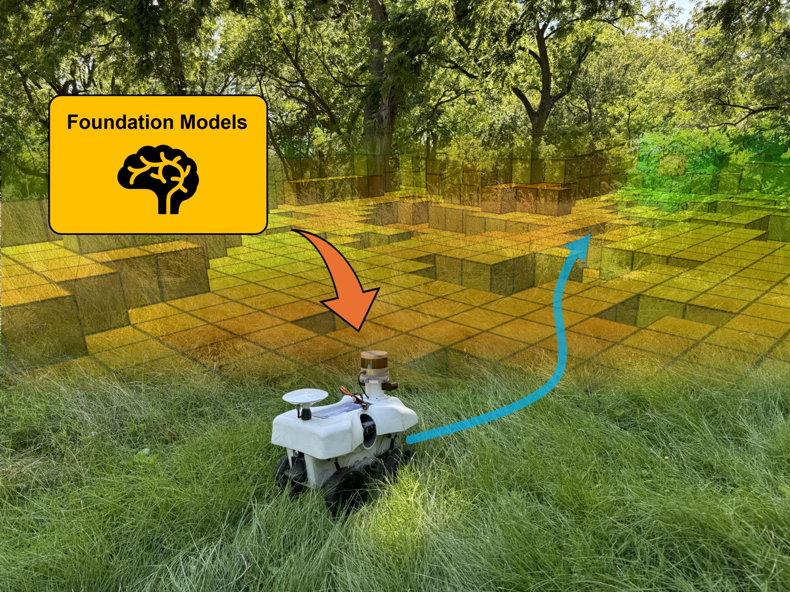
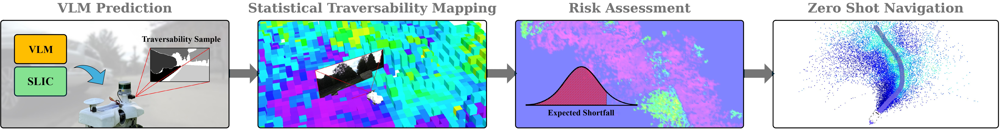

<div align="center">

# ZeST: A VLM-based Zero-Shot Traversability Navigation for Unknown Environments

**IEEE Robotics and Automation Letters · Accepted October 2026**

**[Shreya Gummadi](https://scholar.google.com/citations?user=Sy_MOcwAAAAJ&hl=en)<sup>1†</sup> · [Mateus V. Gasparino](https://scholar.google.com.br/citations?user=UbtCA90AAAAJ&hl=pt-BR&authuser=2)<sup>1†</sup> · [Gianluca Capezzuto](https://scholar.google.com.br/citations?user=NFF2y9oAAAAJ&hl=pt-BR&authuser=2)<sup>2†</sup> · [Marcelo Becker](https://scholar.google.com.br/citations?user=c602uMcAAAAJ&hl=pt-BR&authuser=2)<sup>2</sup> · [Girish Chowdhary](https://scholar.google.com.br/citations?user=pf2zAXkAAAAJ&hl=pt-BR&authuser=2)<sup>1</sup>**

<sup>1</sup> Field Robotics Engineering and Science Hub (FRESH), Illinois Autonomous Farm,<br>
University of Illinois at Urbana-Champaign<br>
<sup>2</sup> Mobile Robotics Group, University of São Paulo, São Carlos, Brazil

<sup>†</sup> Equal contribution

<p align="center">
  <a href="https://arxiv.org/abs/2508.19131"></a>
  <a href="https://arxiv.org/pdf/2508.19131"></a>
  <a href="LICENSE"></a>
</p>

</div>

<p align="center">
  
</p>

**ZeST (Zero-Shot Traversability)** treats a vision-language model as a stochastic terrain sensor. It fuses repeated predictions into an uncertainty-aware map and uses that map to navigate unfamiliar indoor and outdoor environments.

🚀 **Zero-shot deployment:** no in-domain training, fine-tuning, or terrain data collection.<br>
🗺️ **Bayesian mapping:** a Normal Inverse Gamma (NIG) posterior separates aleatoric and epistemic uncertainty.<br>
🛡️ **Risk-aware navigation:** CVaR-based RRT* planning and MPPI control favor safer terrain and slow the robot in under-observed regions.<br>
⏱️ **Asynchronous inference:** the accumulated map supports navigation between VLM responses.

## ⚙️ Environment Setup

ZeST runs in a **ROS Noetic catkin workspace**. The original reference environment is Ubuntu 20.04, Python 3.8, PyTorch 2.1.0, and CUDA 12.0.

**Required:** an NVIDIA GPU with a CUDA-enabled PyTorch build. MPPI currently uses CUDA directly; CPU-only PyTorch cannot run the controller.

### ROS dependencies

Install [ROS Noetic](https://wiki.ros.org/noetic/Installation/Ubuntu) on Ubuntu 20.04 first. Noetic is end-of-life; initialize rosdep once and explicitly include its archived distribution:

```bash
sudo apt-get install build-essential cmake python3-pip python3-rosdep python3-virtualenv
# Run only if rosdep has not already been initialized:
sudo rosdep init
rosdep update --rosdistro noetic --include-eol-distros
```

Place this repository in your catkin workspace's `src/` directory. From the workspace root, run:

```bash
source /opt/ros/noetic/setup.bash
rosdep install --from-paths src --ignore-src --rosdistro noetic -r -y
catkin_make -DPYTHON_EXECUTABLE=/usr/bin/python3
source devel/setup.bash
```

### Python environment

From the repository root, create and activate the `env/` environment expected by the launch files. Use Noetic's system Python 3.8 and system-site packages so ROS modules and compiled Python bindings remain compatible:

```bash
python3 -m pip install virtualenv
python3 -m virtualenv --python=/usr/bin/python3 --system-site-packages env
source env/bin/activate
```

### PyTorch

Choose **one** installation path for your platform.

#### Desktop

Install PyTorch 2.1.0 for the MPPI controller:

```bash
python -m pip install "numpy>=1.19.1,<2"
python -m pip install torch==2.1.0
```

See the [official PyTorch installation instructions](https://pytorch.org/get-started/previous-versions/) for CUDA-specific wheels.

#### NVIDIA Jetson

Use an NVIDIA PyTorch build matching your **JetPack release, Python version, and architecture**. The following wheel is the original installation example for **JetPack 5.1.2, Python 3.8, and ARM64**:

```bash
sudo apt-get install libopenblas-dev
python -m pip install "numpy>=1.19.1,<2"
python -m pip install https://developer.download.nvidia.cn/compute/redist/jp/v512/pytorch/torch-2.1.0a0+41361538.nv23.06-cp38-cp38-linux_aarch64.whl
```

For another JetPack release, select the corresponding wheel from [NVIDIA's PyTorch for Jetson instructions](https://docs.nvidia.com/deeplearning/frameworks/install-pytorch-jetson-platform/index.html) instead.

### Python requirements

Finally, from the repository root with `env/` still activated:

```bash
python -m pip install -r requirements.txt
```

## 🧱 VLM Access

ZeST queries **GPT-4o** through the OpenAI API. Create `api_key.txt` in the repository root containing only your API key:

```bash
chmod 600 api_key.txt
```

The deployed model is `gpt-4o-2024-08-06`. The model name and robot-conditioned prompt are defined in [`llm_prediction/scripts/llm_prediction.py`](llm_prediction/scripts/llm_prediction.py). API access requires network connectivity and billing.

## 📍 Minimal Usage

With your ROS workspace sourced, activate the Python environment from the repository root and start ZeST:

```bash
source env/bin/activate
roslaunch llm_prediction run_zest_offline.launch enable_mode:=service
```

In another ROS-configured terminal, replay a recording:

```bash
rosbag play --clock /path/to/recording.bag
```

If the recording uses different sensor or odometry topic names, pass them through the launch arguments in [Connecting your robot](#connecting-your-robot). The offline launch does not rename bag topics automatically.

Set a goal using **2D Nav Goal** in RViz. The offline launch uses simulated time and defaults to `/move_base_simple/goal`; `goal_topic` selects another topic for both the planner and RViz.

**Note:** “offline” means recorded sensor playback, not offline VLM inference. OpenAI API access is still required.

## 🚀 Zero-Shot Navigation

### Connecting your robot

Start your camera, LiDAR, localization, and command drivers. Connect them with these launch arguments:

| Argument | Default topic | Message type |
| :--- | :--- | :--- |
| `image_topic` | `/camera/rgb/image_rect_color/compressed` | `sensor_msgs/CompressedImage` |
| `pointcloud_topic` | `/lidar/points` | `sensor_msgs/PointCloud2` |
| `odom_topic` | `/odom` | `nav_msgs/Odometry` |
| `goal_topic` | `/move_base_simple/goal` | `geometry_msgs/PoseStamped` |
| `cmd_topic` | `/cmd_vel` | **`geometry_msgs/TwistStamped`**, not `Twist` |

Before launching:

- **Sensors:** configure camera intrinsics in [`llm_params.yaml`](image_projection/cfg/llm_params.yaml), sensor transforms in TF, and LiDAR sampling in [`projection.launch`](image_projection/launch/projection.launch).
- **Frames:** use `odom` coordinates for odometry, maps, paths, and goals; goals are not frame-transformed. Odometry's `child_frame_id` must identify the robot base.
- **Robot:** set `robot_length` and `robot_width` in both [`rrt_params.yaml`](rrt_star/config/rrt_params.yaml) and [`mppi_params.yaml`](traversability_mppi/config/mppi_params.yaml); defaults are 0.5 m × 0.3 m. Set MPPI's `reference_speed`, `u_min`, and `u_max` for your robot (forward m/s, angular rad/s).

Activate `env/` and launch, replacing the example topics with your driver's topics:

```bash
roslaunch llm_prediction run_zest.launch \
  image_topic:=/sensors/front/image/compressed \
  pointcloud_topic:=/sensors/lidar/points \
  odom_topic:=/robot/odom \
  cmd_topic:=/robot/cmd_vel_stamped \
  enable_mode:=service rviz:=true
```

Set a goal with **2D Nav Goal** in RViz. The default namespace is `zest`; change it with `namespace:=<name>`.

**Platform constraint:** commands use `linear.x` and `angular.z`; provide an adapter if your driver does not accept `TwistStamped`. Validate the small-wheeled-robot [VLM prompt](llm_prediction/scripts/llm_prediction.py) and fixed actuation gains in the [MPPI model](traversability_mppi/scripts/mppi/kine_model.py) for your robot.

### Enabling and disabling MPPI

MPPI starts **disabled**. Check the map, goal, and command interface before enabling motion:

```bash
rosservice call /zest/traversability_mppi_node/set_enabled "data: true"
# Stop:
rosservice call /zest/traversability_mppi_node/set_enabled "data: false"
```

Replace `/zest` if you changed the namespace. Disabling publishes zero velocity; this is **not a hardware emergency stop**.

**Optional joystick:** use `enable_mode:=joystick` (the launch default), set `joy_topic:=/joy` (`sensor_msgs/Joy`), and press buttons **8 + 1** together to toggle. The enable service is unavailable in this mode.


## 💡 Why ZeST Works

ZeST builds on two key ideas.

(i) **VLM predictions are stochastic measurements.** SLIC divides an image into numbered regions, and the VLM assigns robot-conditioned traversability scores. Repeated observations update a per-cell Normal Inverse Gamma posterior, capturing both measurement variability and uncertainty from limited observations.

<p align="center">
  
</p>

(ii) **Navigation should account for risk and uncertainty.** CVaR summarizes traversability risk for RRT* global planning and MPPI local control. The controller slows in under-observed regions, allowing navigation to continue on the accumulated map while new VLM responses are pending.

In the paper's four navigation scenarios, ZeST achieves **90–100% success** over 10 runs per scenario; no baseline exceeds 60%. See the [paper](https://arxiv.org/pdf/2508.19131) for comparisons, ablations, and latency experiments.

**Limitation:** Bayesian fusion cannot correct systematic VLM errors and may reinforce incorrect predictions.

## Citation

If you find this work useful in your research, please cite:

```bibtex
@article{gummadi2026zest,
  title   = {{ZeST}: A {VLM}-based Zero-Shot Traversability Navigation for Unknown Environments},
  author  = {Gummadi, Shreya and Gasparino, Mateus V. and Capezzuto, Gianluca and Becker, Marcelo and Chowdhary, Girish},
  journal = {IEEE Robotics and Automation Letters},
  year    = {2026},
  note    = {Accepted October 2026; preprint},
  url     = {https://arxiv.org/abs/2508.19131}
}
```

## Acknowledgements

We gratefully acknowledge the contributions of the following open-source projects:

- [S-BKI](https://github.com/ganlumomo/BKISemanticMapping)
- [EBS](https://github.com/junwon-vision/EvSemMap)
- [PyTorch MPPI](https://github.com/UM-ARM-Lab/pytorch_mppi)
